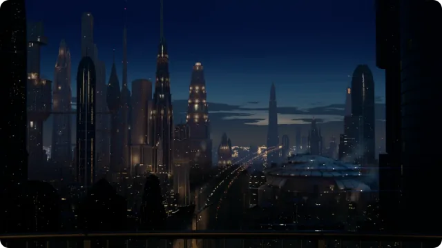
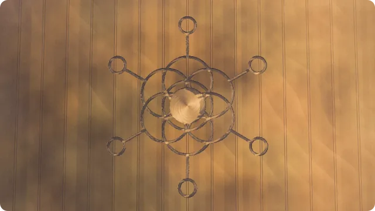
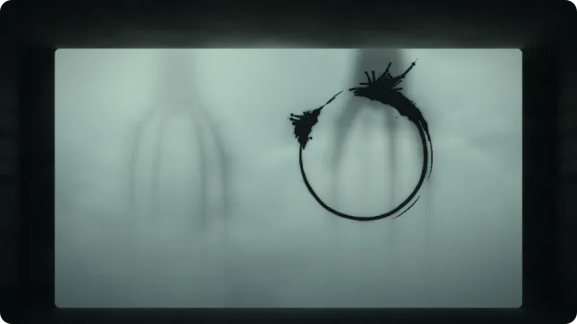

<a href="https://al-turner.com"><picture><source media="(prefers-reduced-motion: reduce)" srcset="assets/banner-still.webp"></picture></a>

A Cornishman in Brum. I lead development at Steadfast Collective, and I tinker with three.js, shaders and frontier AI. Mostly I'm optimistic about where all this is going.

Ask me about plants. 🪴

<picture><source media="(prefers-color-scheme: dark)" srcset="assets/wire-dark.svg"></picture>

### Experiments

  

- [Balcony City](https://al-turner.com/journal/balcony-city/): a living city at blue hour, seen from your balcony
- [Crop Circles](https://al-turner.com/journal/crop-circles/): a crop circle sketching toy
- [Heptapod Ink](https://al-turner.com/journal/heptapod-ink/): draw a circle on the glass, and the heptapods write back

[More experiments](https://al-turner.com/experiments/)

<picture><source media="(prefers-color-scheme: dark)" srcset="assets/wire-dark.svg"></picture>

[Journal](https://al-turner.com/journal/) · [LinkedIn](https://www.linkedin.com/in/al-turner/) · [Email](mailto:alexhenryturner@gmail.com)
